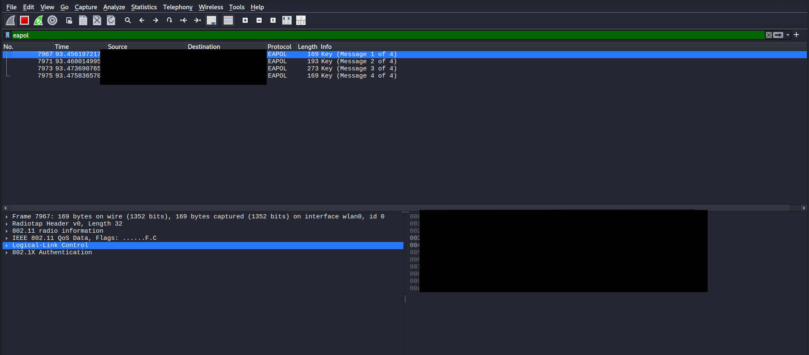
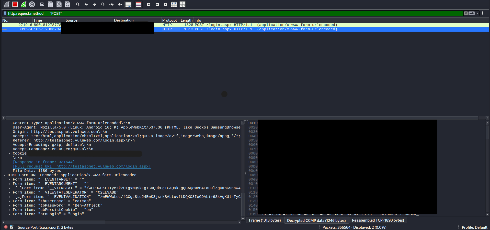

# Wireless Credential Capture

A hands-on wireless security lab demonstrating how unencrypted HTTP credentials can be exposed when traffic is captured and decrypted on a WPA2 network that I own and control.

> **Scope:** This lab was performed only on my own Wi-Fi network, my own Kali Linux virtual machine, and my own smartphone using synthetic test credentials. No third-party systems, accounts, or real credentials were targeted.

## Objective

The goal of this lab was to understand how wireless traffic moves across a WPA2 network and how application-layer data can still be exposed when a website sends login information over plain HTTP instead of HTTPS.

I wanted to demonstrate the full process from configuring a USB Wi-Fi adapter in Kali Linux to capturing the WPA2 handshake, decrypting the wireless traffic in Wireshark, and identifying test credentials inside an HTTP POST request.

## Lab Environment

- **Host:** Windows laptop running VMware Workstation
- **Guest OS:** Kali Linux
- **Wireless Adapter:** Realtek RTL8812AU USB Wi-Fi adapter
- **Target Device:** Personal smartphone
- **Network:** Personal WPA2 2.4 GHz Wi-Fi network
- **Tools:** Wireshark, Aircrack-ng, VMware
- **Test Application:** `testaspnet.vulnweb.com`

## Lab Setup

The Kali VM was left on VMware NAT so it could still access the internet through its virtual Ethernet interface.

The external Realtek USB Wi-Fi adapter was then passed directly into the Kali VM through VMware. This gave Kali direct access to the physical wireless interface for monitor-mode packet capture.

I verified that Kali could see the adapter with:

```bash
lsusb
iwconfig
ip a
```

## 1. Install and Load the Wireless Driver

I updated the Kali package index and installed the Realtek DKMS driver used by the RTL8812AU adapter:

```bash
sudo apt update
sudo apt install realtek-rtl88xxau-dkms -y
sudo reboot
```

After rebooting, I confirmed that the adapter was still recognized:

```bash
lsusb
iwconfig
```

## 2. Put the Adapter Into Monitor Mode

To prevent background networking services from changing the adapter state, I stopped conflicting processes:

```bash
sudo airmon-ng check kill
```

Then I placed the wireless interface into monitor mode:

```bash
sudo airmon-ng start wlan0
```

I verified the interface state with:

```bash
iwconfig
```

The adapter remained named `wlan0` on my system, but the interface showed that it was operating in **Monitor** mode.

## 3. Identify and Lock the Wi-Fi Channel

I used `airodump-ng` to identify the channel used by my 2.4 GHz test network:

```bash
sudo airodump-ng wlan0
```

Once I identified the correct channel, I locked the adapter to that channel:

```bash
sudo iwconfig wlan0 channel <target_channel>
```

I confirmed the channel remained set correctly:

```bash
iwconfig wlan0
```

This was important because the smartphone and monitoring adapter had to be operating on the same wireless channel.

## 4. Configure WPA2 Decryption in Wireshark

Inside Wireshark I opened:

**Edit → Preferences → Protocols → IEEE 802.11**

I enabled wireless decryption and added a `wpa-pwd` entry in this format:

```text
<Wi-Fi-password>:<SSID>
```

Because this was my own WPA2 network, I already knew the Wi-Fi password and SSID.

## 5. Capture the WPA2 4-Way Handshake

I started a Wireshark capture on the monitor-mode wireless interface and applied this display filter:

```text
eapol
```

I then disconnected and reconnected my test smartphone to the Wi-Fi network.

Wireshark captured the full WPA2 4-way handshake:

- Message 1 of 4
- Message 2 of 4
- Message 3 of 4
- Message 4 of 4



Capturing the handshake allowed Wireshark to derive the session keys needed to decrypt the smartphone's WPA2 traffic using the network credentials I had already configured.

## 6. Generate Test HTTP Login Traffic

After confirming the handshake, I cleared the `eapol` filter.

On my smartphone, I opened the deliberately insecure test application at:

```text
http://testaspnet.vulnweb.com/login.aspx
```

I submitted synthetic test credentials through its HTTP login form.

No real usernames or passwords were used during this lab.

## 7. Isolate the Login Request

Back in Wireshark, I applied:

```text
http.request.method == "POST"
```

This isolated HTTP requests where form data was being submitted to the server.

I selected the `POST /login.aspx` request and expanded:

**HTML Form URL Encoded**

Wireshark displayed the form parameters in plaintext, including the synthetic username and password entered from the smartphone.



The successful capture demonstrated that although WPA2 protected the wireless link, the application itself was transmitting the login information over unencrypted HTTP.

## What I Learned

The biggest lesson from this lab was that **WPA2 encryption and HTTPS protect different layers**. Decrypting WPA2 traffic does not automatically expose credentials; the test credentials were visible only because the login was sent over plain HTTP.

The main technical bottlenecks were:
- Capturing the complete **EAPOL 4-way handshake**
- Keeping the wireless adapter locked to the correct channel
- Configuring the correct WPA2 decryption key in Wireshark
- configuring Network setting on VMware, host device and usb adapter for a smooth packet capture.

The main defensive takeaway is that **sensitive data should always use HTTPS and should not rely on Wi-Fi encryption alone for protection**.

## Skills Demonstrated

- Kali Linux
- Wireless interface configuration
- Monitor Network Traffic
- Data packet analysis
- WPA2 traffic decryption
- Network troubleshooting
- Security documentation

## Commands Used

```bash
# Verify hardware and interfaces
lsusb
iwconfig
ip a

# Update Kali and install the wireless driver
sudo apt update
sudo apt install realtek-rtl88xxau-dkms -y
sudo reboot

# Prepare the adapter for passive capture
sudo airmon-ng check kill
sudo airmon-ng start wlan0

# Verify monitor mode
iwconfig

# Identify nearby wireless networks and channels
sudo airodump-ng wlan0

# Lock the adapter to the authorized test network's channel
sudo iwconfig wlan0 channel <target_channel>

# Verify the selected channel
iwconfig wlan0
```

Wireshark display filters used:

```text
eapol
```

```text
http.request.method == "POST"
```

**Authorization Notice:** This project documents a controlled cybersecurity practice lab performed exclusively with personally owned equipment and an authorized test environment.
